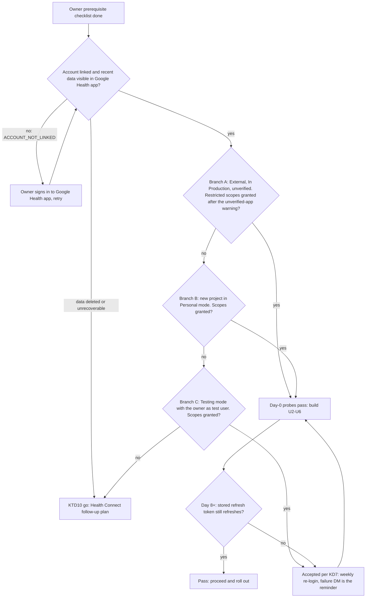
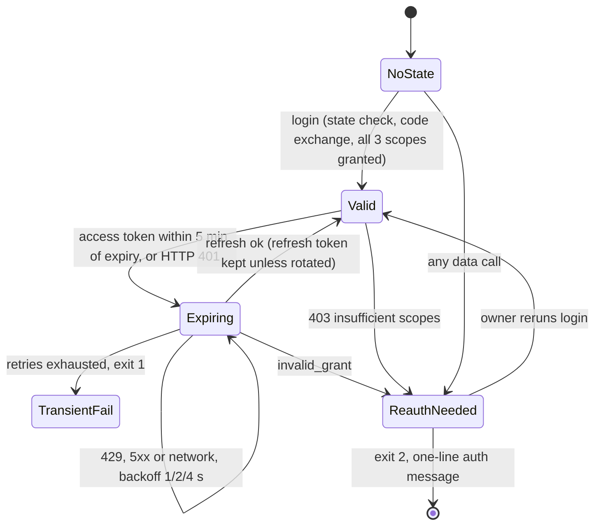
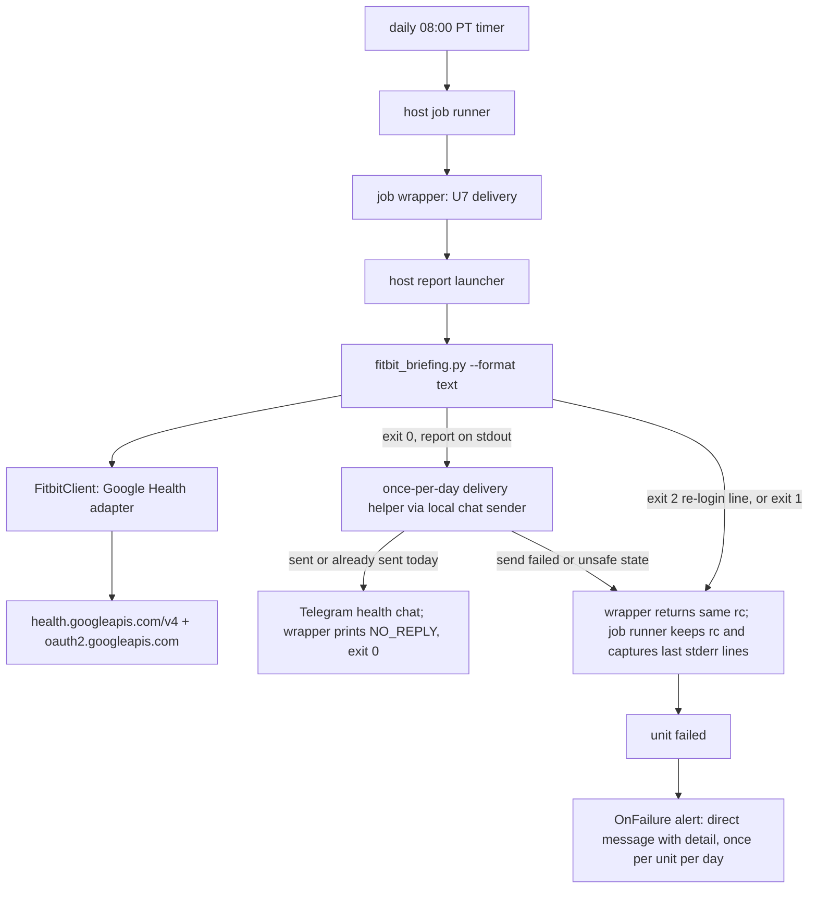

# Google Health API Migration - Plan

**Target repos:** this skill repository for U1 to U6, and the operator's private scheduler repository for U7. Paths are relative to the skill repo unless a unit or line names the scheduler repo.

---

## Goal Capsule

- **Objective:** The owner gets the morning Fitbit health report again every day, built from his own Fitbit data and produced unattended on the scheduler host. When the Google login needs renewing, he is told that same morning, so the report can no longer stop for weeks without anyone noticing.
- **Means:** Swap the auth and data layer inside `FitbitClient` to Google Health API v4 and keep the Fitbit-shaped interface that every consumer already parses (KTD1, KTD3, KTD4). A job wrapper in the scheduler repo sends the finished report to the owner's Telegram health chat (KTD13).
- **Authority:** Owner decisions override everything. Product Contract R-IDs win on behavior, KTDs win on mechanism, and units override neither.
- **Execution profile:** Two PRs, grouped under Implementation Units: PR1 in the skill repo (U1 to U6) and PR2 in the scheduler repo (U7). A `ce-work` executor builds everything, including U1's probes and write-up. The owner does U1's prerequisite checklist, the browser consent, and the comparison against the Google Health app. Rollout on the scheduler host needs the owner's authorization after both PRs merge. It means pulling both checkouts and running the one-time login.
- **Stop conditions:**
  - Stop and switch to the Health Connect follow-up when U1 hits KTD10's go criterion.
  - Stop and ask the owner if any unit would need a non-stdlib dependency installed on the scheduler host (KTD2).
  - Stop if U1 shows that a metric this plan maps as equivalent has no source. Record it and label it unavailable per KD2. Do not invent a proxy for it.

---

## Product Contract

### Summary

Replace the decommissioned Fitbit Web API and Fitbit OAuth in this skill with Google Health API v4 and Google OAuth. The morning report, `alerts.py` and the `fitbit_api.py` CLI keep their current output. Login becomes a one-time browser consent: the command runs on the scheduler host and the owner can consent from any browser. When re-login is needed, the briefing exits non-zero with one clear line, and the scheduler host's job-failure alerting carries that line to the owner. The job wrapper on the scheduler host gains the delivery step it never had: successful reports go to the owner's Telegram health chat. A time-boxed spike on the owner's real account comes first, because the plan's main risk is whether a personal, unverified Google Cloud project can hold the Restricted health scopes long-term.

### Problem Frame

The morning report job on the scheduler host has failed every morning since about 2026-09-20. The last successful token rotation was 2026-09-19. Google has since shut down the legacy Fitbit Web API and OAuth for good: the token endpoint answers HTTP 410. The 410 message says 2026-10-30, while Google's about page says 2026-11-02. The dates disagree, but either way the API is gone and nothing will bring it back. The failure went unnoticed for weeks for three reasons. First, the unit failed, but nothing on the scheduler host alerted on unit failure. The scheduler repo's job-failure alerting change fixed that: it was merged and installed on 2026-11-22, and the report's systemd unit now has its OnFailure drop-in. Second, the report was never delivered on the scheduler host at all. The job wrapper only prints it, and stdout ends up in the journal. Third, the skill's auth state was never self-consistent under systemd: `FITBIT_*` values from the host's credential env file override the token cache, and rotated tokens never get written back to that file.

### Requirements

**Report continuity**

- R1. The morning report is built every day from the owner's Fitbit data, read through Google Health API v4 (`https://health.googleapis.com/v4`) and running unattended on the scheduler host.
- R2. The text, brief and json outputs of `fitbit_briefing.py` keep their current lines, keys, units and formatting for every metric the API provides.
- R3. A report metric that the API does not provide keeps its line and shows a value labeled as unavailable in text output, and `null` in json output. It is never estimated from other data and never silently dropped. Today this applies only to sleep efficiency (see the mapping in the High-Level Technical Design).
- R4. Every `FitbitClient` data method in scope reads from Google Health and returns the Fitbit-shaped JSON it returns today. The in-scope methods are steps, calories, distance, activity summary, yesterday's activities, heart rate (including resting HR), sleep and sleep stages, SpO2, weight and Active Zone Minutes.
- R5. `alerts.py` and the `fitbit_api.py` CLI commands keep their data arguments and output shapes for any `--days` range. Their Fitbit credential flags (`--client-id`, `--client-secret`, `--access-token`) are removed under R8.

**Authentication**

- R6. The owner can finish the one-time login from any browser on any device while the command runs on the headless scheduler host. No port is opened on the scheduler host.
- R7. After login, access refreshes unattended with no owner action until Google revokes or expires the grant.
- R8. Auth state lives in one file that the process owns (mode 0600). Environment variables, `secrets.conf` and command-line flags never supply or override it.

**Failure visibility**

- R9. When re-login is needed, `fitbit_briefing.py` prints no report, exits with code 2, and makes its last stderr line one sentence that names the cause and the exact login command. That line contains the word "auth" and is at most 160 characters. Re-login is needed when there is no auth state, Google returns `invalid_grant` (revoked or expired grant), or a required scope is missing.
- R10. Any other fatal failure exits non-zero, and its last stderr line names the failed operation in a form the owner can act on. The existing tolerance for a non-auth Active Zone Minutes fetch error stays. A re-login condition is never swallowed by that tolerance.

**Delivery**

- R11. Each successful morning report arrives as a message in the owner's Telegram health chat (named by a chat ID env var), at most once per Los Angeles calendar day. A failed or uncertain send fails the job so that the failure alert fires. A failed briefing sends nothing to the chat.

### Key Decisions

- KD1. **Migrate this skill's data-access layer to Google's replacement API and keep the report.** The report is not redesigned. Delivery was never wired up on the scheduler host, and KD6 now sets it. Governs R1, R2, R4, R5. (session-settled: user-directed — chosen over retiring the Fitbit report in favour of another existing health report: the owner wants his Fitbit data back in the same report.)
- KD2. **A metric with no API equivalent is dropped and labeled unavailable, not rebuilt from raw data.** Governs R3. (session-settled: user-directed — chosen over computing proxy scores such as a Daily Readiness estimate: a home-made number would read as Fitbit's own.) Conflict call-out: Fitbit defined sleep efficiency as minutes asleep divided by time in bed, and `SleepSummary` returns both inputs (`minutesAsleep`, `minutesInSleepPeriod`). A faithful recomputation would therefore be cheap. This plan proceeds as settled and labels efficiency unavailable. Daily Readiness was never in this report, so KD2 costs the report only the efficiency value.
- KD3. **Health Connect is the fallback path, not the primary one.** Governs none directly. KTD10 sets how far it goes. (session-settled: user-directed — chosen over building on Health Connect first: Health Connect is on-device Android only, has no cloud API, needs a bridge app on an always-on phone, and lacks SpO2 and Active Zone Minutes.)
- KD4. **The re-login signal relies on the scheduler host's job-failure alerting (the scheduler repo's job-failure alerting change). The skill only fails loudly.** Governs R9, R10. (session-settled: user-approved — chosen over building alerting into the skill or degrading to the job's fallback text: one alert route for every the scheduler host job, and a fallback message reads like a delivered report.)
- KD5. **Google Fit REST API is not an option.** Governs R1. (session-settled: user-approved — chosen over Google Fit REST: Google supports it only to the end of 2026 and has accepted no new sign-ups since 2024-05-01.)
- KD6. **Deliver the morning report to the owner's Telegram health chat (named by a chat ID env var).** Governs R11. (session-settled: user-directed — chosen over leaving the report in the systemd journal, where it has gone since the the scheduler host cutover: the review found it was never delivered, and the owner picked the health chat.)
- KD7. **If no Google setup keeps a refresh token past 7 days (spike branch C), a weekly browser re-login counts as done.** The failure-alert DM is the reminder. Governs R7. (session-settled: user-directed — chosen over treating branch C as a failure that triggers the Health Connect fallback: a weekly login is cheaper than a phone bridge that loses SpO2 and Active Zone Minutes.)

### Success Criteria

- On the first 08:00 run after rollout, the report's systemd unit succeeds, and the report arrives in the Telegram health chat with real values for the previous night and the current day.
- Branches A and B: the report still arrives in the health chat at least 8 days after the login with no owner action. That is past Google's 7-day Testing-mode expiry.
- Branch C (KD7): when the 7-day grant expires, the run that morning sends a failure-alert DM naming re-login. After the owner logs in again, the next run's report arrives in the health chat.
- A deliberate re-login drill produces a failure-alert DM on the same run, and the DM names re-login as the cause. The failure alerting from the job-failure alerting change has been installed on the scheduler host since 2026-11-22.

### Scope Boundaries

**Non-goals considered and not built**

- A stale-data guard that alerts when the phone stops syncing. The owner reads the report daily and sees "No data" or zeros there. That would change if zero-value reports are found to go unnoticed.
- A warning before the grant expires (for example, Google's 6-month-unused rule). The job uses the grant daily, and any expiry still fails loudly under R9. That would change if Google adds a fixed lifetime for production grants.
- Webhook subscriptions. One pull each morning is enough. That would change if the report needs data that arrives after 08:00.
- Keeping the legacy Fitbit client as a fallback. The API answers 410 and will not come back.
- A local OAuth callback listener on the scheduler host. R6 is met by pasting the redirect URL back.
- Changing `None bpm` rendering when resting HR is missing. This is existing behavior. It is an open item only if U1 shows today's resting HR is routinely absent at 08:00.
- The 0/1/2 exit contract and a token `status` command for entry points no job runs (`alerts.py`, the `fitbit_api.py` CLI, a standalone auth check). The only scheduled Fitbit job runs the briefing. Those entry points still fail non-zero with the auth error message. That would change if a job starts running them.
- Revoking the spike's Google tokens. Revoking a token ends the whole grant for that user and client, which would also kill the scheduler host's login. Deleting the files is enough (U1, U3).

### Deferred to Follow-Up Work

- **Health Connect fallback**, conditional on KTD10's go criterion. It needs its own plan.
- **Dead legacy paths**: in the scheduler repo, a legacy report workflow, its contract test, and a legacy report script. On the scheduler host, a stale copy of that workflow.
- **Consumer-side text**: the host agent's skill description on the scheduler host. The job registry's mini PRD moves into U7.
- **Credential cleanup after cutover is verified**: remove the stale `FITBIT_*` values from the host's credential env file and the legacy `secrets.conf` on the scheduler host, and the `FITBIT_*` pattern in the operator's credential-routing allowlist. Each is a credential change that needs the owner's authorization.
- **Repo debris**: the git-tracked dangling `fitbit-analytics` symlink.

### Open Questions

Blocking:

- The owner must complete the prerequisite checklist in U1 before U3 and U4 can be verified against live data. U2 and U7 do not wait on it.

Deferred to the owner, non-blocking:

- Which Telegram topic in the health chat should get the report? U7 uses the topic ID env var that the morning daily note already posts to. Changing it is a one-variable edit.

Deferred to implementation (U1 settles these):

- Desktop or Web OAuth client type. Google's Health setup doc uses a Web Server client with redirect `https://www.google.com`. KTD4 works with either.
- How Google heart-rate zones map to Fitbit's zones (`MODERATE`, `VIGOROUS`, `PEAK` against Fat Burn, Cardio, Peak), and whether the Active Zone Minutes rollup values are already credited (2x for cardio and peak).
- The exact filter for selecting a night's sleep session (`list` or `reconcile`), and the maximum rollup window for each data type.
- Whether today's `daily-resting-heart-rate` exists at 08:00.

### Sources

- Repo research dossier (machine-local, not in the repo): endpoint inventory, auth internals, scheduler-host runtime facts.
- Web research dossier (machine-local, not in the repo): Google Health API, OAuth publishing status, Health Connect, Google Fit.
- Google Health API discovery document `https://health.googleapis.com/$discovery/rest?version=v4`, fetched and read 2026-11-22. Schemas checked: `ActiveMinutesByActivityLevel`, `TimeInHeartRateZoneValue`, `DailyHeartRateZones`, `DailyRestingHeartRate`, `Sleep`, `SleepSummary`, `Exercise`, `MetricsSummary`, `ActiveZoneMinutesRollupValue`, `DistanceRollupValue`, `TotalCaloriesRollupValue`, `Floors`, `DailyOxygenSaturation`, `Weight`, `DailyRollUpDataPointsRequest`. Methods checked: `dataPoints` `list`, `reconcile`, `dailyRollUp`.
- Google Health setup and publishing status: `https://developers.google.com/health/setup.md.txt`. Verification threshold: `https://developers.google.com/health/developer-checklist.md.txt`. Personal project mode: `https://support.google.com/cloud/answer/13464323`.
- The scheduler repo: the host job runner (preserves a failing exit code), the shared job runner (`classify_failure` provider_auth patterns, last-detail capture of 3 stderr lines capped at 200 characters), the failure notifier (alert detail, per-unit-per-day suppression), the job-failure alerting change (merged and installed 2026-11-22). Delivery precedent: the shared delivery-state helper (the shared once-per-identity delivery helper), the local chat sender (chunked local chat sender), an existing morning job that posts to the same chat (the same health chat and topic), the scheduler repo's wrapper-owned delivery learning (wrapper-owned delivery and `NO_REPLY`).
- Doc-review result (machine-local, not in the repo). It is the source of the delivery finding, which was verified read-only on the scheduler host.

---

## Planning Contract

### Key Technical Decisions

- KTD1. **Keep `FitbitClient`, its exception names and its Fitbit-shaped return values. Translate Google responses inside the client.** Implements R4 and R5 under KD1. Briefing, alerts and the CLI parse Fitbit field names directly, and only `FitbitClient`, `FitbitAuthError` and `FitbitReauthRequiredError` are imported from outside (`REFRESH_MAX_AGE_HOURS` goes away under KTD9). An adapter is the smallest diff and leaves the briefing parser untouched. The rejected alternative was a neutral data model with rewritten consumers. A future Health Connect source would emit the same Fitbit-shaped dicts.
- KTD2. **Stdlib only (`urllib`, `json`, `hashlib`, `secrets`, `fcntl`). No `google-auth` or `requests`.** The scheduler host runs system Python 3.12 without a venv, any install needs authorization, and the repo is stdlib-only today.
- KTD3. **One auth state file, `~/.fitbit-analytics/google-health.json` (0600, written atomically under the existing lock pattern).** It holds the OAuth client id and secret imported at first login, the refresh token, the access token, its expiry and the granted scopes. A re-login reuses the stored client credentials, so the command in the alert runs as written. The client JSON (kept in the operator's password manager) is needed only on first login or after the state file is lost. Only login writes the refresh token. Runtime refresh updates the access token and expiry, and the refresh token only if Google rotates it. Nothing reads tokens or client credentials from env or `secrets.conf`. This removes the the host's credential env file override defect on the scheduler host and needs no credential-routing change. The rejected alternative was new `GOOGLE_HEALTH_*` env names: they would bring back the frozen-env problem and need a credential-routing allowlist change.
- KTD4. **Login is an authorization-code flow with PKCE and `state`, completed by pasting the redirect URL back.** The CLI prints the consent URL with `access_type=offline` and `prompt=consent`, without `include_granted_scopes`, requesting `googlehealth.activity_and_fitness.readonly`, `googlehealth.health_metrics_and_measurements.readonly` and `googlehealth.sleep.readonly`. The owner opens it in any browser and pastes back the URL the browser lands on. The CLI checks `state`, exchanges the code, and rejects a grant that is missing any of the three scopes, because Google's granular consent lets the user uncheck one. The redirect URI comes from the imported client JSON, so a Desktop client (loopback) and a Web client (`https://www.google.com`) both work. Satisfies R6.
- KTD5. **Refresh on demand against `https://oauth2.googleapis.com/token`.** Client credentials go in the POST body. Refresh runs before a request when the access token expires within 5 minutes, and once more after a 401. A response without a `refresh_token` keeps the stored one. Google `invalid_grant` raises `FitbitReauthRequiredError`, and so does a 403 whose error names insufficient scopes. 429, 5xx and network errors keep the current backoff (1, 2, 4 s) and then raise `FitbitAuthError`. A preflight refresh that needs re-login is no longer swallowed, unlike today's `_request`. Satisfies R7 and R9.
- KTD6. **Exit-code contract for `fitbit_briefing.py` only: 2 means re-login needed, 1 means any other failure, 0 means a report was printed.** Code 2 reuses `refresh_tokens.py`'s existing meaning. Other entry points are out of scope (see Scope Boundaries). Under the host job runner, any non-zero code fails the unit even though the job registry carries fallback text, so the job-failure alerting's `OnFailure=` fires. The 160-character cap and the word "auth" in R9 keep the message inside the job runner's 200-character last-detail capture and make it classify as `provider_auth`.
- KTD7. **Bucket days by civil date in the host's local timezone.** The scheduler host runs America/Los_Angeles, the owner's zone. Daily metrics use `dailyRollUp`, which works on civil dates. A night's sleep belongs to the date it ends, matching Fitbit's `dateOfSleep`. When a date has several sessions, the main sleep comes first, so `sleep[0]` keeps meaning "last night".
- KTD8. **The adapter splits date ranges at each data type's maximum rollup window and merges the results in date order.** The dossier puts this at 14 days for heart-rate and total-calories types and 90 for the others; U1 confirms the figures. It also follows `nextPageToken` (sleep and exercise pages hold at most 25 items). This keeps R5's "any `--days`" contract.
- KTD9. **Delete the Fitbit rotation machinery.** That means `refresh_tokens.py`, `REFRESH_MAX_AGE_HOURS`, the rewriting of `secrets.conf`, the JWT expiry decode and the env and secrets precedence logic. A new login-only `scripts/google_health_auth.py` replaces them. The machinery existed only because Fitbit refresh tokens were single-use and rotated. Google's normally are not, so keeping it would leave dead code that can still disagree with the state file.
- KTD10. **Health Connect is designed but not built.** Go criterion: U1 shows that no Google Cloud project setup available to the owner, Testing mode included, gives this account the restricted scopes at all, or that the account's data is gone. Branch C's weekly re-login is accepted under KD7 and does not trigger it. When the criterion fires, a separate plan builds this shape: a bridge app on an always-on Android phone pushes to a receiver declared in the scheduler host's config. The receiver yields KTD1's Fitbit-shaped dicts, and SpO2 and Active Zone Minutes show as unavailable per KD2. Building it now would add a phone dependency and a listener that the primary path does not need.
- KTD11. **Test fixtures are synthetic.** The repo is public. Fixtures copy the shapes U1 observes, never the owner's values, tokens or identifiers.
- KTD12. **The spike runs outside the repo with throwaway requests, in `~/.local/state/google-health-spike/` (0700) on the development host.** Only findings and synthetic fixtures are committed. This keeps U1 from depending on U3 and keeps live tokens out of the worktree. The skill's `.gitignore` also gains `client_secret*.json` and `google-health*.json` as a backstop (U3).
- KTD13. **Delivery lives in the scheduler repo's job wrapper script, built on the shared once-per-identity delivery helper with the local chat sender as the sender.** Implements R11 under KD6. The wrapper runs the briefing and captures stdout. On exit 0 it delivers the report to the chat and topic named by the chat ID and topic ID env vars, with identity `morning-fitbit:<LA date>`. Then it prints `NO_REPLY`. On a non-zero exit it sends nothing, passes the briefing's stderr through unchanged, and returns the same code, so KTD6 and the job-failure alert still apply. A delivery-state return other than 0 makes the wrapper exit non-zero. These helpers already supply once-per-day idempotency, locking and the rule against retrying partial sends. Both variables already reach the unit through the host credential drop-in. The rejected alternative was sending from inside the skill: delivery is wrapper-owned in the job registry (`delivery_owner: wrapper`), and the skill is a public repo.

### High-Level Technical Design

**Spike decision branches (U1)**

Verification with a third-party security review is not a branch the owner can complete in reasonable time. It applies above 100 users or for public apps. It is recorded as an option for the owner only.

**Auth state lifecycle (U3, KTD3 to KTD6)**

**Runtime, delivery and failure flow on the scheduler host (R9, R10, R11, KD4, KTD13)**

**Metric mapping (R2, R3, R4; U1 verifies the rows marked "verify")**

| Report field or method | Fitbit source | Google Health v4 source | Status |
|---|---|---|---|
| `steps_today`, 7-day steps | `activities-steps` | `steps` `dailyRollUp` | equivalent |
| `calories_today`, 7-day calories | `activities-calories` | `total-calories` `dailyRollUp` `kcalSum` | equivalent |
| `distance_today` (km) | `summary.distance` | `distance` `dailyRollUp` `millimetersSum` / 1e6 | equivalent |
| `floors_today` | `summary.floors` | `floors` `dailyRollUp` | equivalent |
| `active_minutes` | `veryActiveMinutes + fairlyActiveMinutes` | `active-minutes` `dailyRollUp`, `VIGOROUS + MODERATE` | equivalent, verify |
| `resting_hr` | `restingHeartRate` | `daily-resting-heart-rate` `beatsPerMinute` | equivalent, verify 08:00 availability |
| `hr_zones` minutes, `avg_hr` estimate | `heartRateZones[]` minutes, min, max | `time-in-heart-rate-zone` `dailyRollUp` durations plus `daily-heart-rate-zones` thresholds | equivalent, verify zone mapping |
| `sleep_hours` | `sleep[0].duration` | `sleep` session interval (`minutesInSleepPeriod`) | equivalent |
| `awake_count` (minutes awake) | `minutesAwake` | `SleepSummary.minutesAwake` | equivalent |
| `sleep_efficiency` | `efficiency` | none | unavailable per KD2 |
| Yesterday's activities | `activities[]` name, duration, calories | `exercise` `displayName`, `activeDuration`, `metricsSummary.caloriesKcal` | equivalent |
| Yesterday's Active Zone Minutes | four AZM fields | `active-zone-minutes` `dailyRollUp` `sumInFatBurn/Cardio/PeakHeartZone` | equivalent, verify credit semantics for the total |
| `get_sleep_stages` | sleep `levels.summary` | `sleep` `stagesSummary` (`AWAKE`, `LIGHT`, `DEEP`, `REM`) | equivalent |
| `get_spo2` | `spo2` | `daily-oxygen-saturation` | equivalent, sparse readings |
| `get_weight` | `body/weight` | `weight` `weightGrams` | equivalent, Aria or manual entries only |

### Assumptions

- The owner's Fitbit account was migrated to a Google account before the 2026-05-19 deadline, and its data still exists. U1 checks this first.
- The phone's Google Health app syncs overnight data before 08:00, as the Fitbit app did before.
- The health chat accepts posts from the local chat sender to the chat and topic named by the chat ID and topic ID env vars, as the morning daily note already does.

---

## Implementation Units

### PR1: Google Health migration in the skill repo

Waits on: nothing.

### U1. Spike: confirm long-lived Google Health access with the owner's account

**Goal:** Settle whether this account and a personal Google Cloud project can hold the Restricted `googlehealth.*` scopes with a refresh token that outlives 7 days, and record the real response shapes the adapter must parse.

**Requirements:** R1, R6, R7; KTD4, KTD8, KTD10, KTD12.

**Dependencies:** None. The owner's prerequisite checklist below gates it.

**Files:** `references/google-health-api.md` (new; findings and the verified mapping), `tests/fixtures/google_health/*.json` (new; synthetic, per KTD11).

**Who does what:** The owner does the checklist below, the browser consent and the app comparison in step 3. He passes the redirect URL to the implementer. The implementer (the `ce-work` executor on the development host) does everything else: the code exchange, the probes, the branch record, the day-8 refresh, the write-up, the fixtures and the token cleanup.

**Owner prerequisite checklist** (only the owner can do these):

1. Confirm the Fitbit account was migrated to a Google account, then sign in to the Google Health app on the phone and confirm last night's sleep and today's steps appear.
2. Under the personal Google account (not a work Workspace account), create a Google Cloud project. When creation offers a Personal or sole-user mode, note it, because the choice cannot be undone. Branch B uses a separate project created in that mode.
3. Enable the Google Health API in the project.
4. In Google Auth Platform, set the user type to External and add the owner as a test user. Add the three `googlehealth.*.readonly` scopes from KTD4, then set the publishing status to In Production.
5. Create an OAuth client: a Web application with redirect URI `https://www.google.com`, as in Google's Health setup doc. Download the client JSON and store it in the operator's password manager. Then delete the downloaded copy.
6. Do the consent in a browser when the spike asks. Accept the "Google hasn't verified this app" warning if it appears, and screenshot what Google shows.
7. Keep the Google Health app allowed to run in the background on the phone.
8. After both PRs merge, authorize the rollout on the scheduler host: pulling both checkouts and running the login.

**Approach** (implementer, except where step 3 names the owner):

1. Day 0: complete a throwaway code exchange outside the repo, reading the client JSON from the operator's password manager (KTD12). Record which warnings appeared, the fields in the token response (`refresh_token`, `expires_in`, `scope`), and any granular-consent behavior.
2. Day 0: for the last 8 days, call each data type in the mapping table with the method the table names. Record the response shapes, the enum values, the maximum windows and the pagination. Also check whether today's resting HR exists at 08:00.
3. Day 0: the owner compares one day's values against the Google Health app: steps, zone minutes, AZM total, sleep duration and minutes awake. This settles the zone mapping and the AZM credit question.
4. Follow the spike flowchart's branches and record the branch reached. Branch C needs no further owner decision (KD7).
5. Day 8 or later: refresh with the day-0 refresh token and record the result. A failure moves the plan to branch C and does not stop the work. U2 to U7 do not wait for this.
6. Write the findings and the final mapping into `references/google-health-api.md`. Write synthetic fixtures that copy the observed shapes.
7. Delete the spike directory on the development host once the day-8 result is recorded. Delete the dev state file from the live smoke after the scheduler host login works. Do not revoke the tokens (see Scope Boundaries).

**Test expectation:** none. This is a discovery unit. Its fixtures are consumed by the tests in U4.

**Verification:** `references/google-health-api.md` names the branch reached, the client type, the token response fields, a confirmed source for every mapping row (or a KD2 "unavailable" label), and the day-8 refresh result once known. The fixtures contain no real values. The spike directory is gone from the development host.

### U2. Characterize the briefing output and give the raw calls client methods

**Goal:** Pin today's briefing output with golden tests before the data layer changes. Route the two raw `_request` calls through client methods so the swap has a single seam.

**Requirements:** R2, R4; KTD1.

**Dependencies:** None.

**Files:** `scripts/fitbit_briefing.py`, `scripts/fitbit_api.py`, `tests/test_fitbit_briefing.py` (new), `tests/fixtures/briefing/` (new; synthetic Fitbit-shaped inputs and golden text, brief and json outputs).

**Approach:**

1. Build a fake client that returns synthetic Fitbit-shaped dicts, and patch `fitbit_briefing.FitbitClient` with it.
2. Capture the text, brief and json goldens from the current code before changing anything.
3. Add a client method for the logged activities of one date. Make the briefing use it and the existing `get_active_zone_minutes`, replacing the raw calls at `fitbit_briefing.py` lines 326 and 331.
4. Re-run the goldens unchanged.

This seam catches parsing and formatting regressions in the briefing. It misses adapter mapping errors, which U4 covers.

**Execution note:** Capture the goldens from the unmodified code first. This is characterization coverage for legacy code.

**Patterns to follow:** `tests/test_fitbit_auth.py` (`unittest`, `mock.patch.object`, `sys.path` insert).

**Test scenarios:**

- A full synthetic day produces text output equal to the golden byte for byte. The day: steps 8,421; calories 2,310; distance 6.12; floors 9; very active 20 plus fairly active 15; resting HR 58; zones Fat Burn 42 min (98 to 137), Cardio 12 (137 to 166), Peak 3 (166 to 220); sleep duration 27,000,000 ms, efficiency 91, minutes awake 38; a 7-day series; one exercise "Walk" of 1,800,000 ms and 160 cal; all four AZM fields.
- The same day in `--format json` equals the golden dict, including `avg_hr` computed from zone midpoints.
- The same day in `--format brief` equals the golden.
- A day with every list empty matches the golden that records current behavior: steps 0, "Duration: No data", and `None bpm` for resting HR.
- An Active Zone Minutes fetch that raises a non-auth error omits the AZM section and leaves the rest of the report equal to the golden.
- After the raw calls are replaced, all of the goldens above still pass, and the fake client sees no `_request` call from the briefing.

**Verification:** The goldens pass before and after the seam change, and `fitbit_briefing.py` no longer builds any API path itself.

### U3. Google OAuth: state file, refresh, and the login CLI

**Goal:** Replace Fitbit OAuth with the Google auth layer and remove the rotation machinery.

**Requirements:** R5, R6, R7, R8, R9; KTD2, KTD3, KTD4, KTD5, KTD9, KTD12.

**Dependencies:** U1 (client type, token response fields, scope behavior).

**Files:**

- `scripts/google_health_auth.py` (new; state file, lock, refresh, `login`)
- `scripts/fitbit_api.py` (remove Fitbit auth internals and the CLI credential flags, keep the exception names)
- `scripts/alerts.py` (remove the credential flags)
- `scripts/refresh_tokens.py` (delete)
- `.gitignore` (add `client_secret*.json`, `google-health*.json`)
- `tests/helpers.py` (new; `FakeResponse` and `http_error` moved from the deleted test file)
- `tests/test_google_health_auth.py` (new)
- `tests/test_fitbit_auth.py` (delete; its lock and atomic-write cases move to the new file)

**Approach:**

1. Move the lock and atomic-write helpers out of `FitbitClient` with their current behavior.
2. Point the module-level path constant at the state file so tests can patch it, as `TOKEN_CACHE_PATH` is patched today.
3. `login` takes `--client-secrets <path>` on first use. On a re-login it reuses the client credentials already in the state file (KTD3). It prints the consent URL, reads the pasted redirect URL from stdin or `--redirect-url`, and writes the state only after every check passes.
4. Remove the `--client-id`, `--client-secret` and `--access-token` flags from `alerts.py` and the `fitbit_api.py` CLI. Remove the matching `FitbitClient` constructor arguments (R5, R8).
5. Make all error messages actionable, and never print a token or secret, consistent with the current `_mask_token`.

**Patterns to follow:** The lock, `mkstemp`, `fsync` and `os.replace` sequence in today's `fitbit_api.py`.

**Test scenarios:**

- Login with matching `state` and a valid code POSTs the code, the PKCE verifier and the client's redirect URI. It writes a 0600 state file holding the refresh token, the expiry and the three scopes.
- Login with a mismatched `state` fails and writes nothing.
- Login whose grant lacks `googlehealth.sleep.readonly` fails with a message naming the missing scope and writes nothing.
- A login token response without a `refresh_token` fails with a message telling the owner to retry consent.
- The consent URL contains `access_type=offline`, `prompt=consent`, the PKCE challenge and all three scopes, and does not contain `include_granted_scopes`.
- An access token about to expire triggers a body-parameter POST to `oauth2.googleapis.com/token`. A response without a `refresh_token` keeps the stored one, and the new expiry is persisted.
- A refresh answered with `invalid_grant` raises `FitbitReauthRequiredError`.
- A refresh answered with 503 twice and then 200 succeeds after backoff, with sleeps patched. Four 503s raise `FitbitAuthError`, not the re-login error.
- With no state file, the first data call raises `FitbitReauthRequiredError` naming the login command.
- Denied path: `FITBIT_ACCESS_TOKEN`, `FITBIT_REFRESH_TOKEN` and a `secrets.conf` with tokens are all present, and the client still uses only the state file. This covers R8.
- Two concurrent refreshes POST once, using the same thread-based pattern as today's lock test.
- A re-login without `--client-secrets` against an existing state file reuses its client id and secret and replaces only the token fields.
- A first login without `--client-secrets` and with no state file fails with a message saying to fetch the client JSON from the password manager.
- `alerts.py --access-token x` is rejected as an unknown argument.

**Verification:** The tests pass. No reference to `api.fitbit.com`, `REFRESH_MAX_AGE_HOURS` or the `secrets.conf` rewrite remains in `scripts/`.

### U4. Google Health data adapter behind the Fitbit-shaped methods

**Goal:** Make every in-scope `FitbitClient` data method read from Google Health v4 and return the Fitbit-shaped JSON its consumers parse.

**Requirements:** R1, R2, R4, R5; KTD1, KTD5, KTD7, KTD8.

**Dependencies:** U1 (mapping, shapes, windows), U2 (seam), U3 (auth).

**Files:** `scripts/fitbit_api.py`, `tests/test_google_health_adapter.py` (new), `tests/fixtures/google_health/*.json` (from U1).

**Approach:**

1. Point `_request` at `https://health.googleapis.com/v4/users/me/...`, keeping its role as the single HTTP choke point with preflight refresh and one 401 retry (KTD5).
2. Map each method per the mapping table. Convert units at the adapter boundary: millimeters to km, grams to kg, durations to ms or minutes.
3. When `get_heartrate` or `get_active_zone_minutes` needs several data types, call them separately and merge the results into one Fitbit-shaped value.
4. Return Fitbit's empty structures when there is no data, so the existing "No data" and 0 paths still apply.
5. Map 400 `ACCOUNT_NOT_LINKED` to a `FitbitAuthError` whose message tells the owner to sign in to the Google Health app. That is exit 1, not re-login.

**Patterns to follow:** The `FakeResponse` and `http_error` helpers in `tests/helpers.py` (moved there by U3).

**Test scenarios:**

- `get_steps` over 8 days returns `activities-steps` entries with `dateTime` and string `value` in date order.
- `get_activity_summary` returns `summary.distance` in km (6,120,000 mm becomes 6.12), `floors`, and very plus fairly active minutes from `VIGOROUS` and `MODERATE`.
- `get_heartrate` returns `restingHeartRate` and Fat Burn, Cardio and Peak zones with minutes, min and max, per the zone mapping U1 recorded. With no resting HR point, `restingHeartRate` is absent.
- `get_sleep` for date D returns the session that ends on D, main sleep first and a nap second. It carries `duration` in ms and `minutesAwake`, and has no `efficiency` key.
- `get_sleep_stages`, `get_spo2`, `get_weight` and `get_distance` each map their fixture to the documented Fitbit shape. Weight in grams becomes kg.
- The logged-activities method for yesterday returns `activities[]` with `name`, `duration` in ms and `calories` from the exercise fixture.
- `get_active_zone_minutes` returns all four AZM fields, with the total computed per U1's credit finding.
- A 30-day `get_heartrate` call is split at the maximum window into chunks whose merged output has 30 unique dates in order.
- A sleep response with a `nextPageToken` is followed to its second page.
- A 401 refreshes once and retries. A second 401 raises.
- A 403 naming insufficient scopes raises `FitbitReauthRequiredError`.
- 400 `ACCOUNT_NOT_LINKED` raises `FitbitAuthError` with the "sign in to the Google Health app" message.
- Integration: the U2 golden day, served as Google fixtures through a fake `urlopen`, produces text output equal to the U2 golden except the efficiency line. `alerts.py --days 7 --json` produces the same alert list as with the Fitbit-shaped fake.

**Verification:** The adapter tests pass, and the U2 goldens differ only on the line KD2 governs.

### U5. Loud re-login exit and unavailable labels in the consumers

**Goal:** Make the briefing fail with the R9 contract when re-login is needed, and label sleep efficiency unavailable.

**Requirements:** R3, R9, R10; KTD6.

**Dependencies:** U2, U3, U4.

**Files:** `scripts/fitbit_briefing.py`, `tests/test_fitbit_briefing.py`, `tests/fixtures/briefing/` (golden updated on the efficiency line only).

**Approach:**

1. Catch `FitbitReauthRequiredError` ahead of the generic handler, print the single R9 line, and exit 2.
2. Make the Active Zone Minutes tolerance re-raise `FitbitReauthRequiredError`.
3. For other failures, make the one-line `ERROR:` summary (at most 160 characters, naming the failed operation) the only stderr output in unattended runs. Print the traceback only when stderr is a terminal. The job runner keeps the first 200 characters of the last 3 stderr lines joined, so a traceback printed ahead of the summary would push the summary out of the alert.
4. Text output prints the efficiency line as unavailable, for example "Efficiency: unavailable (not provided by Google Health API)". Json output keeps `sleep_efficiency: null`.

**Test scenarios:**

- `FitbitReauthRequiredError` from the first fetch gives exit 2, empty stdout, and exactly one stderr line. That line contains "auth" and the login command, is at most 160 characters, and has no traceback.
- `FitbitReauthRequiredError` raised inside the AZM fetch gives exit 2, not a report without its AZM section.
- A generic `FitbitAuthError` (network exhausted) with stderr not a terminal gives exit 1 and exactly one stderr line, which starts with `ERROR:`, names the failed operation and is at most 160 characters. The last 3 stderr lines, joined and cut to 200 characters as the job runner does, contain that whole line.
- The full golden day prints "Efficiency: unavailable (not provided by Google Health API)", every other line stays equal to the U2 golden, and json output has `sleep_efficiency: null`.

**Verification:** The tests pass. A manual run with an empty `HOME` on any host prints only the re-login line and returns 2.

### U6. Rewrite setup, skill and reference docs for Google Health

**Goal:** Make the public docs describe the new login, state file, exit codes and data source.

**Requirements:** R1, R3, R6, R9.

**Dependencies:** U1, U3, U4, U5.

**Files:**

- `SETUP.md` (rewrite: the U1 checklist, `google_health_auth.py login` on a headless host, no refresh cron)
- `README.md` (Features, Setup, Token Refresh Behavior, Automation, Structure)
- `SKILL.md` (frontmatter `description` and `metadata.openclaw.requires.env`, Quick Start, Authentication, Environment, Automation, the API methods table, and the example JSON keys corrected to the real `awake_count`)
- `references/api.md` (delete; replaced by `references/google-health-api.md` from U1)
- `references/metrics.md` (efficiency marked unavailable, AZM definition)
- `docs/PRIVACY.md`, `docs/TERMS.md` (Fitbit Web API wording)

**Approach:** Document the briefing's exit codes 0, 1 and 2, and the state file path and mode. Say that the client JSON is needed only on first login, and tell the reader to keep it in a password manager. The public docs do not say where the operator keeps it. State the shutdown-date discrepancy in one line (2026-10-30 in the 410 message, 2026-11-02 on Google's page). Remove every Fitbit developer-app and `dev.fitbit.com` instruction.

**Test expectation:** none. Documentation only.

**Verification:** No doc in the repo tells the reader to use `api.fitbit.com`, `dev.fitbit.com`, `refresh_tokens.py` or `FITBIT_*` tokens. A reader following `SETUP.md` alone reaches a working login.

### PR2: Telegram delivery wrapper in the scheduler repo

Waits on: nothing. The two PRs can merge in either order. Only the rollout needs both. This group lives in a different repository, so it cannot share a PR with PR1.

### U7. Deliver the morning report to the Telegram health chat

**Goal:** Make the job's wrapper script send a successful report to the owner's Telegram health chat and pass failures through unchanged.

**Requirements:** R9, R10, R11; KD6, KTD6, KTD13.

**Dependencies:** None. It is tested with a stub briefing and a stub sender.

**Files** (the scheduler repo):

- The job's wrapper script (replace the bare `exec` with the KTD13 wrapper)
- A new wrapper contract test (new)
- The job registry (morning report mini PRD: inputs name the Google Health auth state, the artifact is the report in the Telegram health chat, and `silent_failure` describes the new re-login failure)
- A scheduler or workflow doc that lists the morning report, if it names the delivery target (implementer checks the scheduler docs)

**Approach:**

1. Keep `FITBIT_REPORT_SCRIPT` as the briefing entry point. Run it into temp files, with a bounded timeout that fits inside the job's 240 s.
2. On exit 0 with non-empty stdout, resolve and validate the chat and thread from the chat ID and topic ID env vars. Call the shared once-per-identity delivery helper with the local chat sender, identity `morning-fitbit:$(TZ=America/Los_Angeles date +%F)`, and a state directory under the scheduler's state root. On 0, print `NO_REPLY`.
3. On exit 0 with empty stdout, a missing or invalid target, or any non-zero delivery return, print a `morning-fitbit delivery:` line naming the cause to stderr and exit 1.
4. On a non-zero briefing exit, forward its stderr unchanged as the last lines and exit with the same code. Send nothing.
5. Keep the sender seam the other tests use (a sender-bin override) so tests never reach the real sender.

**Execution note:** Read the scheduler repo's wrapper-owned delivery learning and the scheduler repo's PR rules first. Copy target validation from that existing morning job.

**Patterns to follow:** an existing digest wrapper (the shared once-per-identity delivery helper caller), an existing news wrapper (the local chat sender on the scheduler host), an existing stubbed wrapper contract test (stubbed wrapper contract test).

**Test scenarios:**

- A stub briefing prints a report and exits 0. The stub sender receives exactly that text once, with the health chat id and thread. The wrapper prints `NO_REPLY` and exits 0.
- A second run on the same LA date sends nothing and exits 0 (already delivered).
- A stub briefing exits 2 with the R9 line. Nothing is sent, the wrapper exits 2, and the last stderr line is the R9 line unchanged.
- A stub briefing exits 1. Nothing is sent and the wrapper exits 1.
- The stub sender fails. The wrapper exits non-zero, and its last stderr line names the delivery failure.
- The chat ID env var is unset or not numeric. Nothing is sent and the wrapper exits 1 with a target error.
- The stub briefing exits 0 with empty stdout. Nothing is sent and the wrapper exits 1.

**Verification:** The new wrapper contract test passes, and the scheduler repo's existing contract tests still pass (the job-runner contract test, the unit-render contract test). The job registry stays valid JSON.

---

## System-Wide Impact

- **Scheduler host runtime:** U7 changes only the job's wrapper script and the job's mini PRD. The host job runner already preserves a failing exit code, so the job's exit 2 fails the unit. The job runner captures the last 3 stderr lines and classifies them as `provider_auth`. The job-failure alerting (merged and installed 2026-11-22) sends the alert once per unit per day, which gives a daily reminder until the owner logs in again.
- **Telegram health chat:** It gains one message per day alongside the morning daily note in the same topic.
- **Secrets:** At runtime the skill stops reading the `FITBIT_*` values that a credential drop-in loads from the host's credential env file. They become dead values, and their cleanup is deferred follow-up work.
- **Production checkouts:** The skill checkout on the scheduler host is a plain clone, and the unit runs from the scheduler repo's checkout. Rollout is a pull of both plus one login, and needs the owner's authorization. The host's report launcher script keeps working because the script path and arguments do not change.
- **Other consumers:** The `alerts.py` and `fitbit_api.py` CLI shapes are kept (R5). The only other callers, a legacy report script and workflow in the scheduler repo, are already dead paths and are deferred follow-up work.

---

## Risks & Dependencies

| Risk | Decision |
|---|---|
| An unverified personal project cannot hold the Restricted scopes, or its refresh token dies after 7 days | U1 settles this first through branches A to C. Branch C is accepted (KD7) and stays loud through R9. KTD10 applies only if no setup grants the scopes at all |
| A real Google `invalid_grant` body differs from the test fixtures | Only the missing-state path is drilled. A mismatch would exit 1 instead of 2, which is still loud but labeled as a generic failure. The first real expiry (weekly under branch C) confirms it |
| A Telegram send has an uncertain outcome | The shared once-per-identity delivery helper does not retry partial sends. The job fails and alerts, and the owner reconciles by hand |
| The account was never linked, or unmigrated data was deleted | U1's first check. Deleted history cannot be recovered on any path |
| Zone mapping or AZM credit semantics differ from Fitbit | U1 compares against the app before U4 maps them |
| `dailyRollUp` or the sleep shape changes in `v4` | `v4` is Google's production surface, and `v4beta` is not used. U4's fixtures catch parser drift in tests, and R10 makes a runtime break loud |
| Overnight data has not synced by 08:00 | This is unchanged from Fitbit and accepted as a non-goal |

---

## Verification Contract

| Gate | Evidence | When |
|---|---|---|
| Unit and golden tests | `python3 -m unittest discover -s tests`, run from the skill repo root (stdlib `unittest`; the repo has no CI, linter or type checker) | U2 to U5 |
| Wrapper contract | The new wrapper contract test plus the existing job-runner and unit-render contract tests, run in the scheduler repo | U7 |
| Syntax | `python3 -m py_compile scripts/*.py` | Every unit |
| Spike record | `references/google-health-api.md` complete per U1 Verification | U1 |
| Live smoke | After a login on the development host with a dev state file, `python3 scripts/fitbit_briefing.py --format text` shows values matching the Google Health app for the same day, and `python3 scripts/alerts.py --days 7` runs | Before merge |
| Legacy removal | No `api.fitbit.com` or `oauth2/token` Fitbit endpoint and no `REFRESH_MAX_AGE_HOURS` in `scripts/` | Before merge |
| Rollout readback | The unit status shows success at the next 08:00. The delivery-state file for that date is `delivered`, and the owner confirms the message arrived in the Telegram health chat | After the owner-authorized rollout |
| Grant survival (branches A and B) | The report still arrives in the health chat on day 8 or later after the scheduler host login, with no owner action | After rollout |
| Weekly cycle (branch C) | On the expiry morning the failure-alert DM names re-login. After the owner logs in again, the next run's report arrives in the health chat | After rollout |
| Re-login drill | The job-failure alerting has been installed on the scheduler host since 2026-11-22. With the owner's approval, on a day the unit has not already failed (its alert fires once per unit per day, Los Angeles time, so a same-day earlier failure suppresses the DM), move the state file aside, start the unit once, confirm the failure-alert DM names re-login, then restore the file | After rollout |

---

## Definition of Done

- U1 through U7 each meet their Verification, and every listed test passes.
- The U2 goldens are unchanged except the efficiency line that KD2 governs.
- No real health values, tokens, client secrets or account identifiers are committed (KTD11). The spike's throwaway scripts and any abandoned approaches are absent from the diff. The spike and dev token files are deleted from the development host.
- The docs match the new behavior (U6), and the morning report mini PRD matches the new delivery (U7).
- After both PRs merge, with owner authorization, three Verification Contract rows are green: rollout readback, re-login drill, and the grant row for the branch U1 reached. That is grant survival for A or B, or the weekly cycle for C. Branch C with a working weekly re-login counts as done (KD7).
